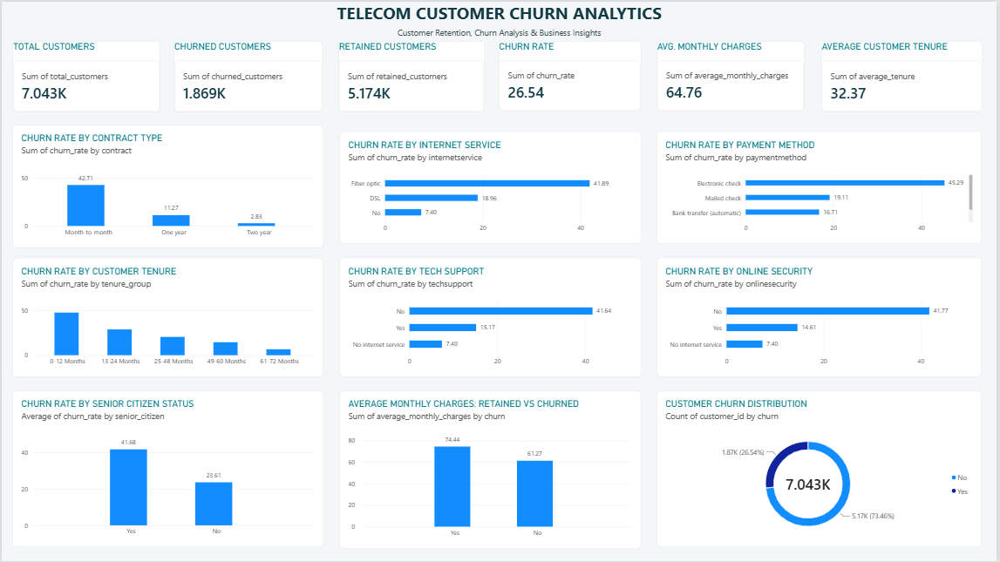
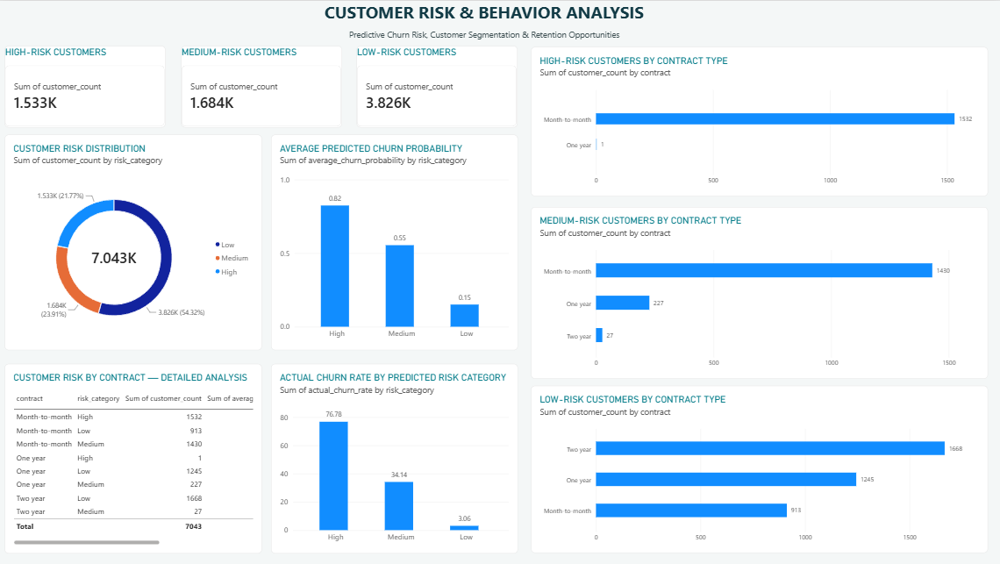
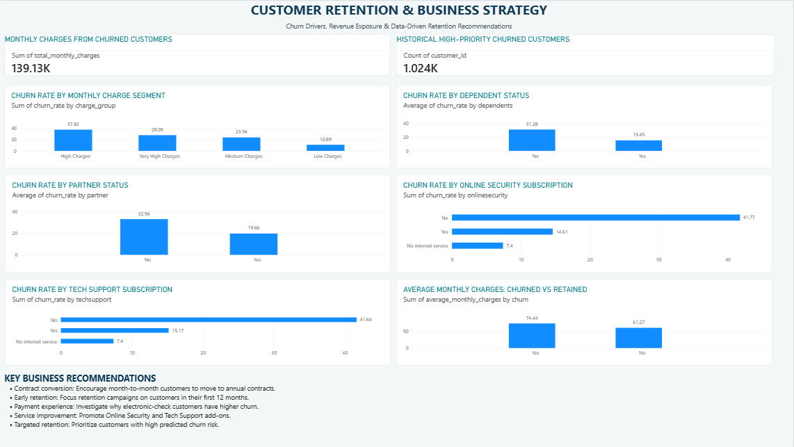

# Telecom Customer Churn Analytics

An end-to-end data analytics and machine learning project focused on understanding customer churn, identifying high-risk customer segments, and developing data-driven retention strategies.

## Project Overview

This project analyzes telecom customer behavior using Python, SQL, Machine Learning, and Power BI.

The objective is to identify key churn drivers, predict customer churn probability, segment customers based on risk, and provide actionable business recommendations.

## Technology Stack

- **Python:** Pandas, NumPy, Matplotlib, Seaborn, Scikit-learn
- **Database:** MySQL
- **Visualization:** Microsoft Power BI
- **Machine Learning:** Logistic Regression, Random Forest, Extra Trees
- **Development:** VS Code, Jupyter Notebook

## Dataset

- Source: IBM Telco Customer Churn Sample Dataset
- Records: 7,043 customers
- Features: 21 original columns
- Target variable: Churn

## Project Workflow

1. Data auditing and quality assessment
2. Data cleaning and preprocessing
3. Exploratory data analysis
4. Customer behavior and churn-driver analysis
5. SQL analysis and analytical views
6. Machine learning model development
7. Customer churn probability prediction
8. Customer risk segmentation
9. Interactive Power BI dashboard development

## Machine Learning Results

Three classification algorithms were evaluated:

| Model | Accuracy | Precision | Recall | F1 Score | ROC-AUC |
|---|---:|---:|---:|---:|---:|
| Logistic Regression | 73.81% | 50.43% | 78.34% | 61.36% | 84.15% |
| Random Forest | 75.66% | 52.87% | 76.47% | 62.51% | 84.12% |
| Extra Trees | 75.51% | 52.80% | 72.99% | 61.28% | 83.15% |

Random Forest achieved the highest F1 score and accuracy among the evaluated models.

## Key Business Insights

- Overall customer churn rate: 26.54%.
- Month-to-month contract churn rate: 42.71%.
- First-year customer churn rate: 47.44%.
- Electronic-check payment churn rate: 45.29%.
- Fiber-optic customer churn rate: 41.89%.
- Customers without Online Security had a churn rate of 41.77%.
- Customers without Tech Support had a churn rate of 41.64%.

## Customer Risk Segmentation

Customers were grouped into three predicted churn-risk categories:

| Risk Category | Customers |
|---|---:|
| High | 1,533 |
| Medium | 1,684 |
| Low | 3,826 |

These risk summaries are exploratory model scores generated on the available dataset. They should not be interpreted as independent validation results.

## Power BI Dashboard

The interactive dashboard contains three analytical pages:

1. Executive Overview
2. Customer Risk & Behavior
3. Retention Strategy

### Dashboard Screenshots

#### Executive Overview


#### Customer Risk & Behavior


#### Retention Strategy


## Project Structure

```text
Telecom Customer Churn Analytics/
│
├── Data/
│   ├── raw/
│   └── processed/
│
├── notebooks/
├── sql/
├── powerbi/
│   └── Telecom_Customer_Churn_Analytics.pbix
│
├── reports/
├── models/
├── screenshots/
├── requirements.txt
└── README.md
```

## Business Recommendations

- Encourage month-to-month customers to consider longer-term contracts.
- Prioritize early-tenure customers for retention campaigns.
- Investigate the high churn associated with electronic-check payments.
- Promote Online Security and Tech Support services.
- Use churn-risk scores to help prioritize retention outreach.

## Limitations

- The dataset is a public sample dataset.
- Model evaluation uses a train-test split.
- Customer-level risk summaries currently include in-sample predictions and require independent validation before operational use.
- Predicted churn probabilities indicate model estimates, not guaranteed customer behavior.

## Author

Developed as an end-to-end portfolio project demonstrating data analytics, SQL, machine learning, and business intelligence skills.
